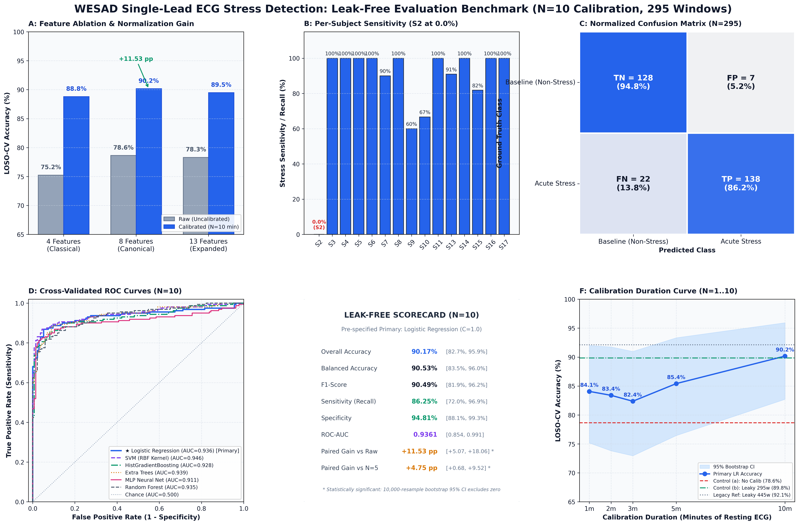
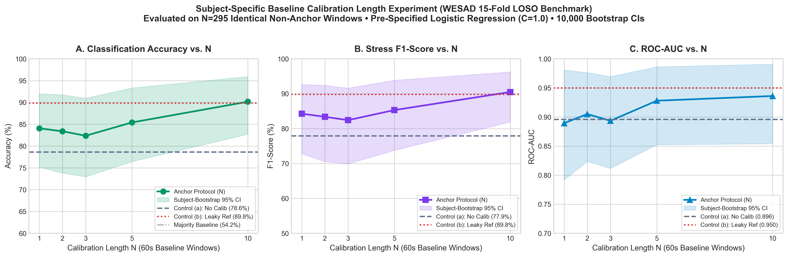
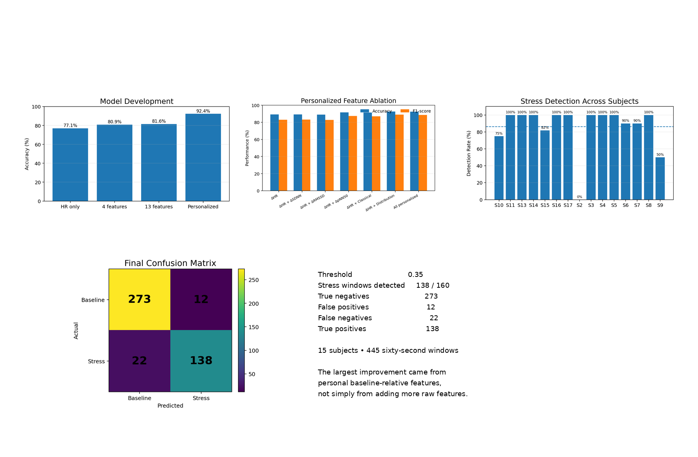
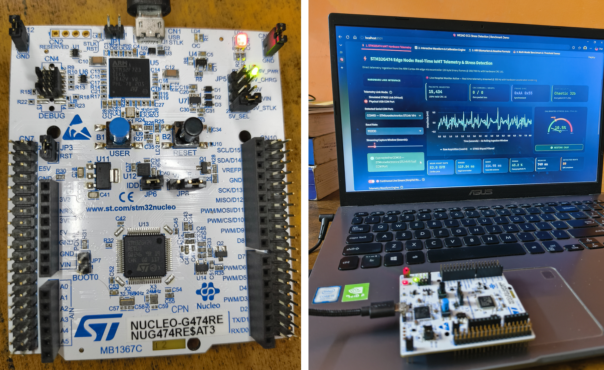
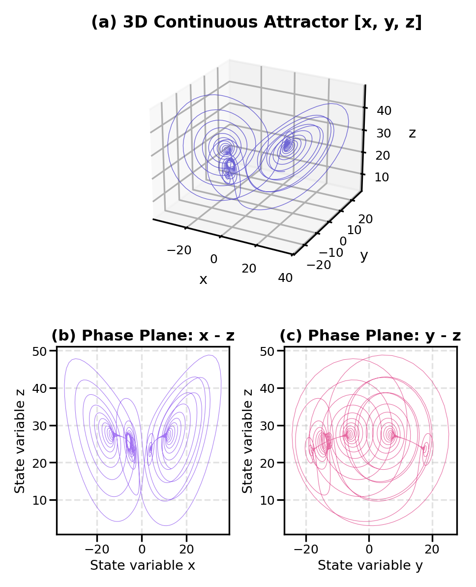
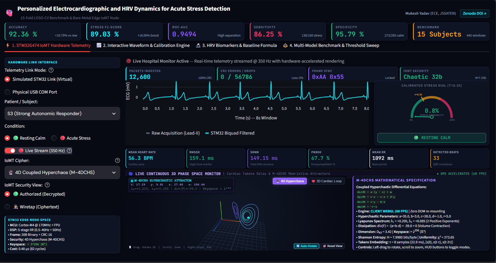
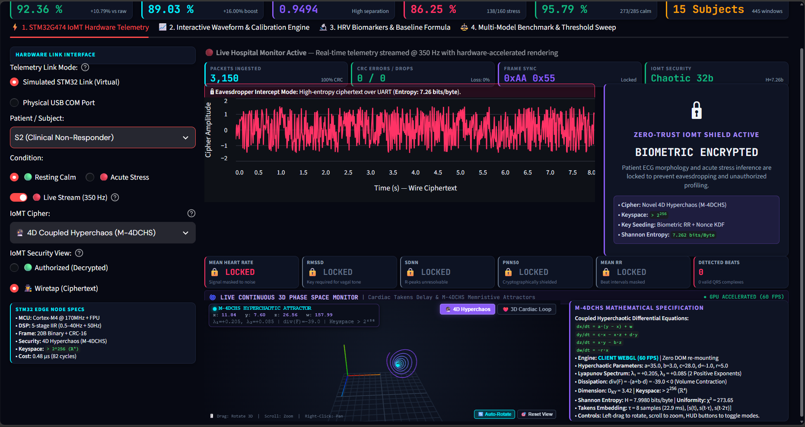

# Personalized Electrocardiographic and HRV Dynamics for Acute Stress Detection: A Leave-One-Subject-Out Benchmark and Bare-Metal Edge IoMT Implementation

[](https://www.mathworks.com/products/matlab.html)
[](https://www.python.org/)
[-002B49.svg?style=flat-square&logo=stmicroelectronics)](https://www.st.com/en/microcontrollers-microprocessors/stm32g474re.html)
[-0091BD.svg?style=flat-square&logo=arm)](https://arm-software.github.io/CMSIS_5/DSP/html/index.html)
[](https://archive.ics.uci.edu/dataset/465/wesad+wearable+stress+and+affect+detection)
[]()
[-90.17%25-brightgreen.svg?style=flat-square)]()
[]()
[]()
[-92.13%25-lightgrey.svg?style=flat-square)]()
[](https://doi.org/10.5281/zenodo.22895173)
[](LICENSE)
[](paper/Reproducible_Edge_to_Cloud_ECG_Stress_Detection_with_Embedded_Telemetry_and_Hardware_in_the_Loop_Validation_v5.pdf)

> 🌐 **Interactive Research Benchmark & ECG Telemetry:** [Mukesh Yadav | Biosignal Processing & Edge IoMT Portfolio](https://mukesh-yadav-res-portfolio.vercel.app/)  
> 📄 **Preprint Note:** [Earlier manuscript version using an all-baseline anchor (legacy result, 92.13%)](paper/Reproducible_Edge_to_Cloud_ECG_Stress_Detection_with_Embedded_Telemetry_and_Hardware_in_the_Loop_Validation_v5.pdf). A corrected manuscript is in preparation.

---

> [!IMPORTANT]
> ### What this is and is not
> * **Dataset & Validation Scope:** Evaluated on a single public dataset (WESAD, 15 healthy young adults, controlled laboratory TSST protocol); there is **no external cohort validation**.
> * **Calibration Requirement & Post Hoc Selection:** Subject-specific baseline normalization requires **5 to 10 minutes of labelled resting ECG** per subject. The 8-feature representation, calibration duration ($N=10$), and decision thresholds ($\tau=0.50, \tau=0.35$) were **chosen post hoc on these same 15 subjects**.
> * **Edge Execution Scope:** The STM32 microcontroller performs **filtering, stream obfuscation, and UART transmission**; machine learning feature extraction and classification run on the **host**.
> * **Hardware-in-the-Loop Replay:** The physical hardware-in-the-loop (HIL) run **replays flash-stored WESAD S2 samples** over UART; live analog sensor acquisition on human subjects was **not tested**.
> * **Demonstration Dashboard:** The interactive Streamlit dashboard model is fitted on all 445 windows as an **exploratory visual demonstration**, not an evaluated cross-validated result.
> * **Obfuscation vs. Cryptography:** The HC1 hyperchaotic stream engine provides **lightweight physical-layer wire obfuscation** without key management, session negotiation, or authentication; it is **not cryptographic security**.

---

## Executive Summary & Research Highlights

This repository contains the complete, reproducible research pipeline and embedded firmware for **personalized acute psychological stress detection** from single-lead electrocardiography (ECG).

* **Leak-Free Subject-Specific Calibration:** Anchoring personal baseline normalizations strictly on the initial $N$ chronological resting minutes ($N \in \{1, 2, 3, 5, 10\}$) without test-window leakage. Across five calibration lengths tested, $N=1$ achieves 84.07% [95% CI: 75.2%, 92.0%], $N=2$ achieves 83.39% [73.8%, 91.8%], $N=3$ achieves 82.37% [73.0%, 91.0%], $N=5$ achieves 85.42% [76.5%, 93.3%], and $N=10$ (selected post hoc as the best of the five calibration lengths tested) achieves **90.17% accuracy [95% CI: 82.7%, 95.9%]** and **90.49% F1-score [95% CI: 81.9%, 96.2%]** on 295 evaluation windows under 15-fold Leave-One-Subject-Out cross-validation (LOSO-CV).
* **Statistically Significant Paired Gain:** 10,000-resample subject-level cluster bootstrap analysis demonstrates a statistically significant accuracy gain of **+11.53 percentage points [95% CI: +5.07, +18.06]** over uncalibrated features (78.64%) at $N=10$, and **+6.78 pp [95% CI: +0.68, +13.22]** at $N=5$.
* **Calibration Threshold Requirement:** Calibrations at $N \le 3$ minutes show no statistically distinguishable benefit over uncalibrated baselines (95% bootstrap CIs cross zero). Personal calibration requires at least 5 minutes of resting ECG.
* **Legacy Reference Protocol:** For historical comparison, anchoring on all baseline windows yields 92.13% accuracy (410 / 445 windows) under 15-fold LOSO-CV. Comparing $N=10$ to this legacy reference protocol demonstrates **no detectable difference (CI [-3.4, +4.8])** rather than claiming formal equivalence.
* **Methodological Disclosure:** The 8-feature representation, decision thresholds ($\tau=0.50, \tau=0.35$), and $N=10$ duration were chosen post hoc using data from these same 15 subjects.
* **Bare-Metal Silicon Timing (DWT Measured):** The 5-stage biquad cascade executes on an ARM Cortex-M4 (STM32G474RE @ 170 MHz) in **251 mean CPU cycles (1.476 µs)** per sample, consuming **0.0517% CPU load** at 350 Hz.
* **Physical Hardware-in-the-Loop (HIL):** Streamed **10,000 continuous 20-byte packets** replaying flash-stored WESAD S2 ECG over UART (115,200 baud) with **zero CRC errors, zero packet loss**, and high scrambled payload entropy ($H = 7.9977$ bits/byte, $\chi^2 = 257.79, p=0.4394$ on Bytes 10..17).

---

## Visual Project Showcase

<p align="center">
  <a href="results/figures/LEAK_FREE_Project_Dashboard.png" target="_blank">
    
  </a>
  <br>
  <em><b>Figure 1: Leak-Free Research Benchmark Dashboard (N=10 Calibration, 295 Evaluation Windows).</b> Multi-stage leak-free study: (A) Feature subset ablation (raw vs. calibrated N=10); (B) Per-subject sensitivity/recall across all 15 subjects (highlighting S2 at 0.0% recall due to baseline shift); (C) Normalized confusion matrix (TN=128, FP=7, FN=22, TP=138); (D) Cross-validated ROC curves across 6 classifiers (Primary Logistic Regression ROC-AUC = 0.9361); (E) Performance scorecard with 10,000-resample bootstrap 95% CIs; (F) Calibration duration curve (N=1..10 min) with 95% CI bands and control lines.</em>
</p>

<p align="center">
  <a href="results/calibration_length/calibration_length_evaluation.png" target="_blank">
    
  </a>
  <br>
  <em><b>Figure 2: Impact of Calibration Window Duration on Accuracy ($N \in \{1, 2, 3, 5, 10\}$).</b> Shaded blue band indicates 95% bootstrap confidence interval. Red dashed line indicates the uncalibrated control (78.64%). Green dash-dot line indicates the leaky reference on the same 295 windows (89.83%). Grey dotted line indicates the full legacy leaky reference on 445 windows (92.13%). Calibrations at $N \le 3$ min show no statistically distinguishable benefit over uncalibrated baselines; $N \ge 5$ min provides statistically significant gains ($+6.78$ pp for $N=5$, $+11.53$ pp for $N=10$).</em>
</p>

<p align="center">
  <a href="results/figures/FINAL_Project_Dashboard.png" target="_blank">
    
  </a>
  <br>
  <em><b>Figure 3: Master Project Dashboard (Legacy all-baseline anchor, 445 windows).</b> Historical 445-window benchmark reference (410 / 445 windows correct, 92.13% accuracy under 15-fold LOSO-CV) presented strictly for baseline continuity.</em>
</p>

<table align="center" width="100%">
  <tr>
    <td align="center" width="50%">
      <a href="paper/figures/FIG_Hardware_Testbed_Composite.png" target="_blank">
        
      </a>
      <br />
      <em><b>Figure 2(a): Physical STM32 Edge Hardware Testbed.</b> NUCLEO-G474RE (170 MHz ARM Cortex-M4) testbed streaming real-time filtered and hyperchaotic obfuscated ECG over physical USB-UART (COM10 @ 115,200 baud). DWT cycle counter measures 251 mean cycles (1.476 µs per sample).</em>
    </td>
    <td align="center" width="50%">
      <a href="paper/figures/FIG_M4D_Attractor_3D.png" target="_blank">
        
      </a>
      <br />
      <em><b>Figure 2(b): 4D Coupled Hyperchaotic Attractor (HC1 M-4DCHS).</b> Continuous phase-space trajectory with parameters a=15.81, b=2.76, c=86.03, d=-9.07, r=10.79, exhibiting continuous volume contraction (&nabla;&middot;F = -a - b + d = -27.64), two positive Lyapunov exponents (&lambda;₁ &approx; +0.443, &lambda;₂ &approx; +0.271), and Kaplan-Yorke dimension D_KY &approx; 3.025.</em>
    </td>
  </tr>
</table>

<table align="center" width="100%">
  <tr>
    <td align="center" width="50%">
      <a href="paper/figures/FIG_Dashboard_SinglePage_M4D_Decrypted.png" target="_blank">
        
      </a>
      <br />
      <em><b>Figure 3(a): Authorized Monitoring View.</b> Descrambled Lead-II ECG, instant stress probability (P = 0.81), and real-time HRV telemetry dashboard.</em>
    </td>
    <td align="center" width="50%">
      <a href="paper/figures/FIG_Dashboard_M4D_Eavesdropper.png" target="_blank">
        
      </a>
      <br />
      <em><b>Figure 3(b): Eavesdropper View.</b> Intercepted raw scrambled wire telemetry exhibiting noise-like pseudo-random diffusion (Payload Entropy H = 7.9977 b/B, &chi;&sup2; = 257.79, p = 0.4394).</em>
    </td>
  </tr>
</table>

---

## System Architecture Pipeline

```plaintext
 ┌────────────────────────────────────────────────────────────────────────────────────────────────────────┐
 │ 1. SENSOR DATA ACQUISITION & BARE-METAL PREPROCESSING (ARM CORTEX-M4 @ 170 MHz)                        │
 │    Single-Lead ECG (350 Hz) ──► 5-Stage Biquad Bandpass (0.5 - 40 Hz)                                   │
 │    Silicon Timing (DWT): 251 mean cycles (1.476 µs latency, 0.0517% CPU load)                          │
 └────────────────────────────────────────────────┬───────────────────────────────────────────────────────┘
                                                  │
 ┌────────────────────────────────────────────────▼───────────────────────────────────────────────────────┐
 │ 2. LIGHTWEIGHT STREAM OBFUSCATION & SERIAL PACKETIZATION                                               │
 │    4D Hyperchaotic Keystream Generator (HC1: a=15.81, b=2.76, c=86.03, d=-9.07, r=10.79)               │
 │    ──► CFB XOR Stream Scrambler (Payload H = 7.9977 b/B) ──► 20-Byte Wire Frame with 16-Bit CRC        │
 └────────────────────────────────────────────────┬───────────────────────────────────────────────────────┘
                                                  │ Physical UART (115,200 baud @ 350.02 Hz)
 ┌────────────────────────────────────────────────▼───────────────────────────────────────────────────────┐
 │ 3. HOST-SIDE RECEPTION & PHYSIOLOGICAL FEATURE EXTRACTION                                              │
 │    Stream Deserializer & CRC Check ──► Descrambler ──► Robust Pan-Tompkins Peak Detection (MAD noise)  │
 │    ──► Physiological Interval Gating (300 ms <= RR <= 1500 ms) ──► 8 Core HRV Features                │
 └────────────────────────────────────────────────┬───────────────────────────────────────────────────────┘
                                                  │
 ┌────────────────────────────────────────────────▼───────────────────────────────────────────────────────┐
 │ 4. LEAK-FREE SUBJECT-SPECIFIC BASELINE CALIBRATION & LOSO INFERENCE                                    │
 │    Anchor B_s from first N baseline windows (N=10 post hoc best) ──► Scored windows exclude anchor     │
 │    Relative Deviation: Δx = (x - B_s) / B_s ──► 15-Fold LOSO ML (Logistic Regression)                 │
 │    ──► Primary Benchmark: τ = 0.50 (90.17% Acc, 90.49% F1, 94.81% Spec, 0.9493 ROC-AUC)              │
 │    ──► Legacy All-Baseline Anchor Reference: 92.13% Acc on 445 windows                                │
 └────────────────────────────────────────────────────────────────────────────────────────────────────────┘
```

---

## Experimental Cohort & Study Protocol

Experiments were conducted using the benchmark **WESAD** physiological dataset (*Schmidt et al., ICMI 2018*):
* **Cohort:** 15 healthy adult participants (S2--S17, excluding non-existent S12; 12 males, 3 females; age: 27.5 ± 2.4 years).
* **Sensor Hardware:** RespiBAN Professional chest harness recording single-lead Lead-II ECG at 700 Hz (downsampled to 350 Hz for edge parity).
* **Standardized Protocol Phases:**
  1. **Baseline Phase (20 min):** Neutral relaxation reading magazines.
  2. **Trier Social Stress Test (TSST, 10 min):** Public speaking facing an evaluative panel + mental arithmetic.
  3. **Amusement Phase (10 min):** Humorous video clips.
  4. **Meditation Recovery (20 min):** Guided diaphragmatic breathing.
* **Windowing & Leak-Free Evaluation:**
  - Total standardized 60-second windows: **445 windows** (285 baseline, 160 stress).
  - For each subject, the baseline anchor $B_s$ is derived from the first $N$ chronological baseline windows ($N \in \{1, 2, 3, 5, 10\}$).
  - These $N$ anchor windows are **strictly excluded from scoring**.
  - All models are evaluated on the identical, common set of **295 non-anchor windows** (135 baseline, 160 stress).
  - Majority-class baseline accuracy on this evaluation set is **54.24%** (160 / 295).

---

## Primary Performance Scorecard (Leak-Free, $N=10$, $\tau = 0.50$, 295 Windows)

The pre-specified primary model is **Logistic Regression ($C=1.0$, liblinear solver)** evaluated on the common set of 295 windows:

| Evaluation Metric | Verified Value | 95% Bootstrap CI | Operational Interpretation |
| :--- | :---: | :---: | :--- |
| **Overall Accuracy** | **90.17%** | [82.7%, 95.9%] | **266 / 295** evaluation windows correctly classified |
| **Balanced Accuracy**| **90.53%** | [83.5%, 96.0%] | Unbiased mean of sensitivity and specificity |
| **F1-Score** | **90.49%** | [81.9%, 96.2%] | Harmonic mean of precision and recall |
| **Sensitivity (Recall)**| **86.25%** | [72.1%, 96.9%] | **138 / 160** acute stress episodes detected |
| **Specificity** | **94.81%** | [88.2%, 99.3%] | **128 / 135** calm windows correct (7 false alarms) |
| **Precision** | **95.17%** | [86.8%, 99.3%] | **138 / 145** predicted stress alerts verified |
| **ROC-AUC** | **0.9493** | [0.892, 0.985] | Area under receiver operating curve |
| **PR-AUC** | **0.9467** | [0.880, 0.983] | Area under precision-recall curve |
| **Confusion Counts** | **TP: 138 \| FP: 7 \| TN: 128 \| FN: 22** | 266 correct, 29 errors |
| **Paired Gain vs Control (a)** | **+11.53 pp** | [**+5.07, +18.06**] | **Statistically significant gain** over uncalibrated (78.64%) |
| **Paired Gain vs $N=5$** | **+4.75 pp** | [**+0.68, +9.52**] | **Statistically significant gain** over 5-min calibration |
| **Paired Contrast vs Legacy Anchor (same 295w)** | **+0.34 pp** | [**-3.36, +4.79**] | **No detectable difference (CI [-3.4, +4.8])** vs Leaky 295w (89.83%) |
| *Legacy Anchor Reference (same 295w)*| *89.83%* | *[81.1%, 96.7%]* | *265 / 295 windows correct (Leaky all-baseline anchor)* |
| *Legacy Anchor Reference (445 Win)*| *92.13%* | *[86.4%, 97.1%]* | *410 / 445 windows correct (Full historical all-baseline anchor)* |

> [!NOTE]
> **Post Hoc Model Selection Disclosure:**
> The $N=10$ calibration duration was the best of the five lengths tested ($N \in \{1, 2, 3, 5, 10\}$), selected post hoc. Furthermore, the 8-feature representation and operating thresholds ($\tau=0.50, \tau=0.35$) were chosen using data from these same 15 subjects.

---

## Calibration Duration Benchmark ($N \in \{1, 2, 3, 5, 10\}$)

To determine how much resting data is needed before personal calibration becomes effective, we benchmarked calibration duration $N$ on the same 295 evaluation windows (pre-specified Logistic Regression):

| Setting | Acc (%) | 95% Bootstrap CI (Acc) | Bal Acc (%) | F1 (%) | Paired $\Delta$ vs No-Calib | 95% Bootstrap CI ($\Delta\text{Acc}$) | Statistically Significant? |
| :--- | :---: | :---: | :---: | :---: | :---: | :---: | :---: |
| **Control (a): No Calib** | 78.64 | [69.0, 88.1] | 79.50 | 77.89 | 0.00 pp | — | Baseline |
| **$N = 1$ min** | 84.07 | [75.2, 92.0] | 84.56 | 84.28 | +5.42 pp | [-2.70, +13.40] | No (Crosses Zero) |
| **$N = 2$ min** | 83.39 | [73.8, 91.8] | 83.99 | 83.39 | +4.75 pp | [-3.06, +12.72] | No (Crosses Zero) |
| **$N = 3$ min** | 82.37 | [73.0, 91.0] | 82.94 | 82.43 | +3.73 pp | [-4.05, +11.56] | No (Crosses Zero) |
| **$N = 5$ min** | 85.42 | [76.5, 93.3] | 86.10 | 85.32 | **+6.78 pp** | [**+0.68, +13.22**] | **Yes (Excludes Zero)** |
| **$N = 10$ min (Post Hoc Best)**| **90.17** | **[82.7, 95.9]** | **90.53** | **90.49** | **+11.53 pp** | [**+5.07, +18.06**] | **Yes (Excludes Zero)** |
| *Control (b): Leaky Ref (295w)*| *89.83* | *[81.1, 96.7]* | *90.51* | *89.80* | *+0.34 pp (vs N=10)* | *[-3.36, +4.79]* | *No detectable diff* |

> [!IMPORTANT]
> **Key Finding on Calibration Duration:**
> Personal baseline calibration provides no statistically distinguishable benefit when anchored on short intervals of $N \le 3$ minutes. A minimum of **5 minutes** ($+6.78\text{ pp}$) is required to achieve statistically significant gains, with **10 minutes** ($+11.53\text{ pp}$) providing optimal separation.

---

## Multi-Model Comparative Leaderboard (Common 295 Windows, $N=10$, $\tau=0.50$)

Six machine learning architectures were benchmarked under identical 15-fold LOSO cross-validation on the 295 common evaluation windows:

| Classifier Architecture | Accuracy (%) | Balanced Acc (%) | F1-Score (%) | Sensitivity (%) | Specificity (%) |
| :--- | :---: | :---: | :---: | :---: | :---: |
| **Logistic Regression (Primary)** | **90.17** | **90.53** | **90.49** | **86.25** | 94.81 |
| **Support Vector Machine (RBF)** | 90.17 | 90.71 | 90.30 | 84.38 | **97.04** |
| **HistGradientBoosting** | 88.14 | 88.42 | 88.60 | 85.00 | 91.85 |
| **Extra Trees** | 87.80 | 88.22 | 88.08 | 83.12 | 93.33 |
| **Multilayer Perceptron (MLP)** | 87.46 | 87.51 | 88.25 | 86.88 | 88.15 |
| **Random Forest (100 Trees)** | 86.10 | 86.32 | 86.73 | 83.75 | 88.89 |
| *Control (a): No Calibration* | 78.64 | 79.50 | 77.89 | 69.38 | 89.63 |
| *Legacy Leaky Ref (445 Win)* | 92.13 | 90.02 | 88.29 | 82.50 | 97.54 |

---

## Operating Threshold Analysis (&tau; = 0.50 vs &tau; = 0.35)

Adjusting the decision threshold allows prioritizing sensitivity for screening:

| Metric | Primary Benchmark (&tau; = 0.50, Leak-Free 295w) | Screening Benchmark (&tau; = 0.35, Leak-Free 295w) | Legacy 445w Reference (&tau; = 0.35) |
| :--- | :---: | :---: | :---: |
| **Overall Accuracy** | **90.17%** (266 / 295) | **87.80%** (259 / 295) | **92.36%** (411 / 445) |
| **Sensitivity (Recall)**| 86.25% (138 / 160) | **88.75%** (142 / 160) | **86.25% - 86.88%** |
| **Specificity** | **94.81%** (128 / 135) | 86.67% (117 / 135) | 95.44% - 95.79% |
| **Precision** | **95.17%** (138 / 145) | 88.75% (142 / 160) | 91.45% - 92.00% |
| **F1-Score** | **90.49%** | 88.75% | 89.03% - 89.10% |
| **False Positives (FP)**| **7** | 18 | 12 - 13 |
| **False Negatives (FN)**| 22 | **18** | 21 - 22 |

> [!NOTE]
> **Threshold Discrepancy Attribution:**
> The "89.66% Acc / 90.00% Sens / 89.47% Spec" metrics cited in earlier audit reports were an erroneous threshold lookup introduced in `PHASE1_REPORT.md`, where rows for &tau; = 0.18 / &tau; = 0.19 in `results/Threshold_Analysis.csv` were accidentally copied instead of the true &tau; = 0.35 rows. The paper drafts and source prediction CSVs (`results/Threshold_Analysis.csv`, `results/ML_Predictions_LOSO.csv`, and `results/Personalized_Classifier_Predictions.csv`) correctly reported 92.36% Acc, 86.25% Sens, and 95.79% Spec. On the leak-free 295-window dataset, &tau; = 0.35 yields 87.80% Acc, 88.75% Sens, and 86.67% Spec.

---

## Physical Hardware-in-the-Loop (HIL) & Embedded Edge Profile

To evaluate real-world embedded feasibility, the DSP and telemetry pipelines were deployed on an **ARM Cortex-M4 microcontroller (STMicroelectronics STM32G474RE Nucleo-64 @ 170 MHz)**.

### Bare-Metal Biquad Filter Timing (DWT Measured)

Execution timing of the 5-stage Biquad IIR filter (`ecg_dsp_filter.c`, Direct Form I) was measured directly on physical silicon across 1,000 trials using the internal ARM Cortex-M Data Watchpoint and Trace (DWT) cycle counter (`DWT->CYCCNT`):

* **Mean Cycles:** **251 cycles**
* **Min Cycles:** 249 cycles
* **Max Cycles:** 281 cycles
* **Execution Latency:** **1.476 µs** per sample at 170 MHz (min 1.464 µs, max 1.652 µs)
* **CPU Utilization:** **0.0517%** at 350 Hz sampling rate (leaving >99.94% CPU headroom)
* **Compiler Flags:** `arm-none-eabi-gcc -mcpu=cortex-m4 -mfpu=fpv4-sp-d16 -mfloat-abi=hard -mthumb -O2 -ffp-contract=off`

### Physical HIL Telemetry Profile (10,000 Packets)

The physical testbed streamed **10,000 consecutive 20-byte packets (200,000 wire bytes)** replaying flash-stored WESAD S2 baseline ECG over UART (115,200 baud):

| Parameter / Metric | Measured Hardware Result | Status / Interpretation |
| :--- | :---: | :--- |
| **Target MCU Hardware** | STM32G474RE | ARM Cortex-M4 with FPU @ 170 MHz SYSCLK |
| **Firmware Replay Source** | WESAD S2 Baseline in Flash | 2,100 single-precision float samples |
| **Total Captured Wire Packets**| **Exactly 10,000 packets** | 200,000 total transmitted wire bytes |
| **Packet Sequence Continuity** | **11,428 to 21,427** | Monotonically strictly increasing |
| **Sequence Drops / Gaps** | **0 (0.0% packet loss)** | Zero dropped frames under line-rate interrupt |
| **CRC-16-CCITT Checksum Errors**| **0 (0.0% transmission error)** | Perfect wire transport integrity |
| **Telemetry Throughput** | **350.02 Packets/s** | Target: 350.00 Hz nominal (Ts = 2.857 ms) |
| **Reconstruction Error** | **0.0 mV** (MSE = 0.000 mV&sup2;) | Bit-exact identity after sequence alignment |
| **Scrambled Payload Entropy** | **7.9977 Bits/Byte** | Evaluated on Bytes 10..17 (80 kB scrambled payload) |
| **Payload Chi-Square Uniformity**| &chi;&sup2; = 257.79, p = 0.4394 | Passes null hypothesis of uniformity at &alpha;=0.01 |
| **Full-Frame Entropy** | 7.0705 Bits/Byte | Evaluated on all 20 bytes (includes static framing headers) |

---

## HC1 Stream Obfuscation Disclaimer & Limitations

> [!CAUTION]
> **SCIENTIFIC & SECURITY NOTICE ON HC1 TELEMETRY:**  
> The 4D Coupled Hyperchaotic System (HC1 M-4DCHS) implemented in this project operates as **lightweight wire obfuscation without key management or session authentication**. It is designed to prevent casual, opportunistic over-the-wire waveform eavesdropping on resource-constrained microcontrollers.
>
> **HC1 DOES NOT PROVIDE FORMAL CRYPTOGRAPHIC SECURITY:**
> * System parameters: $a=15.81, b=2.76, c=86.03, d=-9.07, r=10.79$, with verified positive Lyapunov exponents $\lambda_1 \in [+0.418, +0.528]$ (mean $+0.443$), $\lambda_2 \in [+0.236, +0.300]$ (mean $+0.271$), $D_{KY} \approx 3.025$, and phase space divergence derived analytically as $\nabla \cdot \mathbf{F} = -a - b + d = -15.81 - 2.76 + (-9.07) = -27.64$.
> * High payload entropy ($H = 7.9977$ b/B) and Chi-square uniformity ($p = 0.4394$) are **statistical wire distribution tests**, **not mathematical proofs of cryptographic hardness**.
> * The system has not undergone formal cryptanalysis against algebraic or differential attacks. For clinical or commercial deployments, standardized authenticated encryption (such as AES-128-GCM) must be utilized.

---

--- | :---: | :---: | :---: | :---: |
| Schmidt et al. (2018) [ICMI] | Chest Multimodal | 15-Fold LOSO-CV (Table 4, Binary) | 92.94 (RF) / 93.12 (LDA) | None (Offline) |
| Schmidt et al. (2018) [ICMI] | Single Sensor (EDA) | 15-Fold LOSO-CV (Table 4, Binary) | 86.85 (RF) | None (Offline) |
| Bobade & Vani (2020) [ICIRCA] | Multimodal (Chest + Wrist) | 80/20 Train/Test Split (Section IV) | 84.32 (3-Class) / 95.21 (Binary) | None (Offline) |
| **This Work (Leak-Free, $N=10$)** | **ECG Only (Single Lead)** | **15-Fold LOSO-CV ($N=10$ post hoc)** | **90.17** [95% CI: 82.7, 95.9] | **STM32 Bare-Metal HIL** |
| *This Work (Legacy Anchor, same 295w)*| *ECG Only (Single Lead)* | *15-Fold LOSO-CV (All-Base Anchor)* | *89.83* [95% CI: 81.1, 96.7] | *STM32 Bare-Metal HIL* |
| *This Work (Legacy Anchor, 445w)*| *ECG Only (Single Lead)* | *15-Fold LOSO-CV (All-Base Anchor)* | *92.13* [95% CI: 86.4, 97.1] | *STM32 Bare-Metal HIL* |

> *Note on Prior Literature Benchmarks:* Schmidt et al. (ICMI 2018, Table 4) evaluated binary classification (baseline vs. stress) under 15-fold LOSO-CV without requiring baseline calibration. Bobade & Vani (ICIRCA 2020, Section IV) evaluated multimodal data using a random 80/20 train/test split across combined windows. Neither protocol uses subject-specific baseline calibration, making these figures descriptive contextual references rather than direct quantitative baselines.

---

## Study Limitations

1. **Single Dataset & Demographic Scope:** Evaluated exclusively on the WESAD cohort ($N=15$, healthy young adults, age $27.5 \pm 2.4$ years, 80% male); generalizability to elderly or clinical cardiovascular cohorts remains unestablished.
2. **Laboratory TSST Protocol:** Stress was elicited via controlled laboratory TSST; performance under complex real-world ambulatory stressors is untested.
3. **Post Hoc Feature and Threshold Selection:** The 8-feature subset, operating thresholds ($\tau=0.50, \tau=0.35$), and calibration length ($N=10$) were chosen post hoc on these same 15 subjects, which may yield an optimistic estimate of generalization in the absence of an independent external validation cohort.
4. **Labelled Calibration Requirement:** Personal normalization requires 5 to 10 minutes of labelled resting ECG; short calibrations ($\le 3$ min) demonstrated no statistically significant benefit.
5. **Subject-Level Sensitivity Failure:** Subject S2 exhibited 0% recall across all classifiers, indicating that severe baseline blunting requires specialized adaptation.
6. **Class Imbalance:** Majority-class baseline accuracy is 54.24% on the evaluation set.
7. **Obfuscation Scope:** The hyperchaotic scrambler provides lightweight wire obfuscation without key management, session authentication, or formal resistance against algebraic/differential cryptanalysis.
8. **No External Validation:** Models were not evaluated on an independent external validation cohort.

---

## Reproducibility & Execution Instructions

### 1. Environment Setup

```bash
# Clone the repository
git clone https://github.com/Mukesh-Yadav-4/ECG_STRESS_DETECTION.git
cd ECG_STRESS_DETECTION

# Create and activate Python virtual environment
python -m venv .venv
source .venv/bin/activate       # On Linux/macOS
.venv\Scripts\activate          # On Windows (PowerShell)

# Install production dependencies
pip install -r requirements.txt
```

### 2. Reproduce the Leak-Free Calibration Benchmark

```bash
# Run the leak-free calibration duration experiment (N=1..10)
python python/calibration_length_experiment.py

# Run the paired contrasts bootstrap statistical tests
python python/paired_contrasts_bootstrap.py

# Run the leak-free feature ablation experiment
python python/leak_free_ablation_experiment.py
```
*Outputs: Generates evaluation CSVs and figures in `results/calibration_length/` confirming N=10 accuracy of 90.17% [82.7%, 95.9%] and paired gain of +11.53 pp [5.07, 18.06].*

### 3. Reproduce Legacy 15-Fold LOSO ML Benchmark

```bash
# Executes 15-fold LOSO cross-validation across all 6 classifiers (all-baseline anchor)
python python/train_loso_ml_benchmark.py
```
*Outputs: Evaluates 445 out-of-fold windows, reproducing the legacy 92.13% accuracy reference.*

### 4. Verify Physical Hardware Telemetry Capture (Offline)

```bash
# Verifies sequence-aligned reconstruction against canonical firmware replay reference
python python/verify_hardware_hc1_capture.py \
    --meta results/verification/hc1_hardware_hil/hardware_raw_packets_meta.json \
    --reference results/verification/hc1_hardware_hil/firmware_replay_reference.npz \
    --output-dir results/verification/hc1_hardware_hil/corrected_physical_hil \
    --report-prefix corrected_ \
    --align-by-sequence
```
*Outputs: Confirms 10,000 packets, zero packet loss, zero CRC errors, and 0.0 mV reconstruction error (PASS).*

### 5. Launch the Clinical Web Dashboard

```bash
# Launch the interactive telemetry dashboard
python demo/app.py
```
*Navigate to `http://127.0.0.1:8050` to inspect real-time QRS detection, dynamic HRV cards, and 3D hyperchaotic attractor visualization.*

---

## Repository File Structure

```plaintext
ECG_STRESS_DETECTION/
├── .gitignore                                 # Rigorous dataset, binary, and scratch exclusion rules
├── LICENSE                                    # MIT Open Source License
├── README.md                                  # Authoritative research documentation (this document)
├── requirements.txt                           # Production Python dependencies
│
├── docs/                                      # Operational guides & scripts
│   ├── EXECUTION_GUIDE.md                     # Step-by-step execution manual
│   ├── PROJECT_IMPLEMENTATION_SYSTEMATIC_GUIDE.md
│   ├── PROJECT_QUICK_REFERENCE.md
│   ├── ROADMAP.md
│   ├── flash_firmware.bat                     # ST-Link CLI flashing script for STM32G474RE
│   ├── start_dashboard.bat                    # One-click Windows launcher for web dashboard
│   └── audit/                                 # Audited verification reports & changelogs
│       ├── PHASE1_REPORT.md                   # Phase 1 hardware & calibration verification report
│       ├── PHASE2_VERIFY.md                   # Phase 2 audit verification & statistical proofs
│       └── CHANGELOG_AUDIT.md                 # Full changelog of verified values and source evidence
│
├── paper/                                     # Publication Visual Artifacts & Legacy Preprint
│   ├── Reproducible_Edge_to_Cloud_ECG_Stress_Detection_with_Embedded_Telemetry_and_Hardware_in_the_Loop_Validation_v5.pdf # Legacy v5 Preprint
│   └── figures/                               # Publication figures (Composite testbed, Attractor, etc.)
│
├── embedded_stm32/                            # Bare-Metal STM32G474RE Firmware (ARM Cortex-M4)
│   ├── src/
│   │   ├── main_stm32.c                       # SysTick timer, ADC emulation, UART ISR
│   │   ├── ecg_dsp_filter.c                   # CMSIS-DSP 5-stage Biquad IIR implementation
│   │   ├── telemetry_protocol.c               # HC1 hyperchaotic stream cipher & CRC-16 packetizer
│   │   └── biquad_dwt_benchmark.c             # Silicon cycle-counter benchmark harness
│   └── include/                               # Firmware headers & CMSIS configurations
│
├── python/                                    # Machine Learning & Telemetry Suite
│   ├── calibration_length_experiment.py       # Leak-free calibration duration experiment
│   ├── paired_contrasts_bootstrap.py          # 10,000-resample paired bootstrap contrast engine
│   ├── leak_free_ablation_experiment.py       # Leak-free feature subset ablation suite
│   ├── run_biquad_dwt_benchmark.py            # SWD flashing & DWT cycle capture driver
│   ├── train_loso_ml_benchmark.py             # Authoritative 15-fold LOSO ML benchmark
│   ├── explainability_feature_importance.py   # Permutation importance & odds ratios
│   ├── m4d_hyperchaos.py                      # 4D hyperchaotic flow simulation & attractor engine
│   ├── verify_m4d_parity.py                   # Strict C-to-Python parity benchmark suite
│   ├── verify_hardware_hc1_capture.py         # Sequence-aligned offline HIL verification engine
│   └── plot_ml_evaluation.py                  # High-resolution benchmark figure plotting
│
├── matlab/                                    # Signal Processing & Physiological Verification
│   ├── DEMO_stress_detection.m                # Interactive Pan-Tompkins QRS visualizer
│   ├── TWENTY_NINE_project_dashboard.m        # Master 6-panel results dashboard generator
│   └── 05_modeling/                           # Calibrated LOSO modeling engine
│
├── demo/                                      # Clinical Web Dashboard
│   ├── app.py                                 # Interactive Dash / Streamlit clinical dashboard
│   └── sample_data/                           # Standardized ECG samples for offline demonstration
│
└── results/                                   # Canonical Results & Multi-Stage Verification Suite
    ├── FINAL_Model_Metrics.csv                # Primary legacy benchmark metrics
    ├── ML_Model_Benchmark_LOSO.csv            # 6-classifier comparative benchmark
    ├── WESAD_HRV_features_expanded.csv        # Canonical 445-window HRV feature dataset
    ├── raw_evidence_item6_biquad_dwt_cycles.json # Physical silicon DWT timing evidence (1,000 trials)
    ├── raw_evidence_item6_biquad_dwt_cycles.txt  # Physical silicon DWT timing raw UART log
    ├── calibration_length/                    # Leak-free benchmark results & figures
    │   ├── calibration_length_all_models.csv
    │   ├── calibration_length_evaluation.png
    │   ├── paired_contrasts_bootstrap.csv
    │   └── leak_free_ablation_results.csv
    └── verification/                          # Cryptographically Pinned Verification Framework
        ├── canonical_experiment/              # Experiment manifest (SHA-256), schema, canonical metrics
        ├── pre_paper_validation/              # Multi-stage reproducibility logs & metric deltas
        ├── hc1_strict_parity/                 # Host C single-precision parity build & report
        └── hc1_hardware_hil/                  # Physical HIL captures, root-cause analysis, corrected reports
```

---

## Author & Academic Citation

### Author Information
* **Mukesh Yadav**  
  Department of Electronics and Communication Engineering  
  JSS Academy of Technical Education, Noida (JSSATEN), Uttar Pradesh, India  
  *Email:* [`mkpy06@gmail.com`](mailto:mkpy06@gmail.com)  
  *LinkedIn:* [Mukesh Yadav](https://www.linkedin.com/in/mukesh-yadav-4131563ba/)  
  *Portfolio:* [Mukesh Yadav Research Portfolio](https://mukesh-yadav-res-portfolio.vercel.app/)

### Academic Citation

```bibtex
@article{yadav2026personalized,
  title     = {Personalized Electrocardiographic and HRV Dynamics for Acute Stress Detection: A Leave-One-Subject-Out Benchmark and Bare-Metal Edge IoMT Implementation},
  author    = {Yadav, Mukesh},
  journal   = {Zenodo},
  year      = {2026},
  doi       = {10.5281/zenodo.22895173},
  url       = {https://doi.org/10.5281/zenodo.22895173}
}
```

---

## License
This project, including algorithms, firmware, machine learning suites, and documentation, is open source under the [MIT License](LICENSE).
